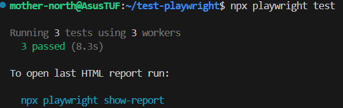

# Тест Playwright

Тесты на Playwright для проверки страницы Fallout 4 в Википедии.

## Что проверяется

1. Текст (заголовок статьи и текста "Bethesda Game Studios")
2. Форма поиска (ввод запроса "Skyrim" и отправка формы)
3. Навигация (переход на другую страницу по внутренней ссылке)

## Запуск

```bash
npm install
npx playwright install
npx playwright test
```

